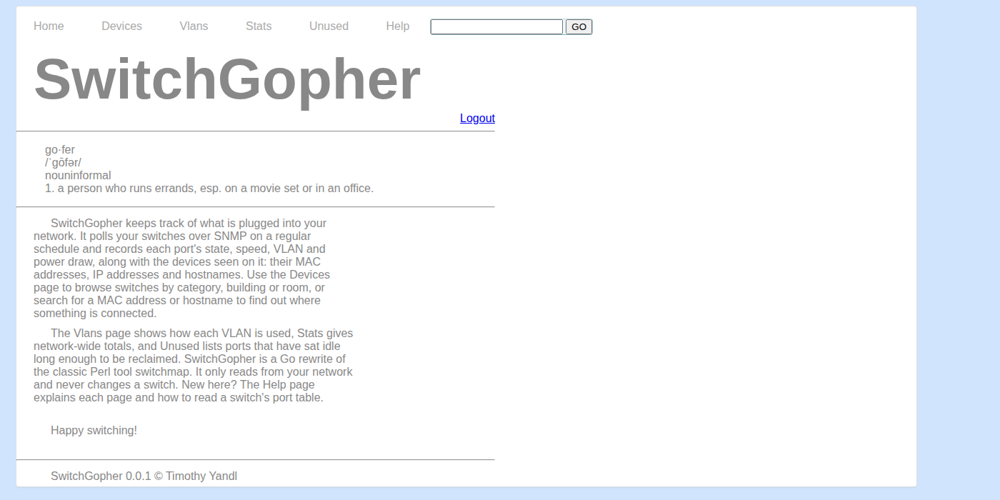
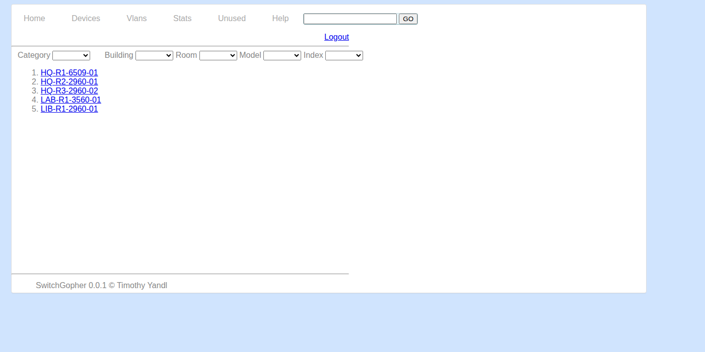
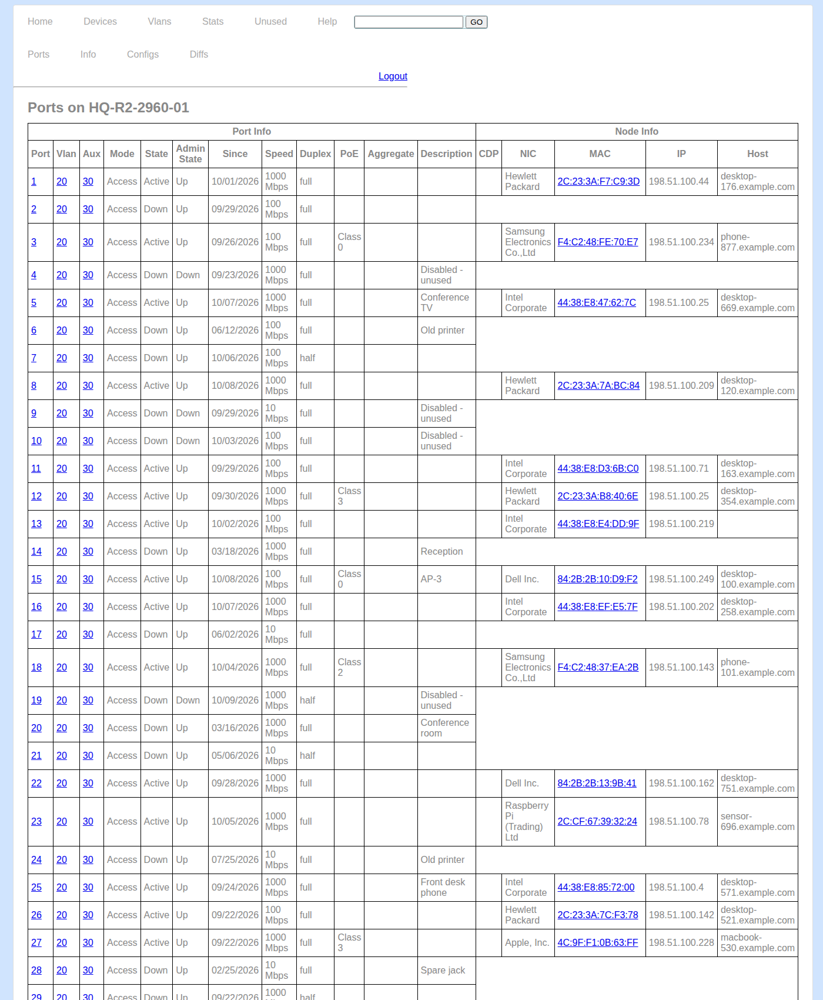
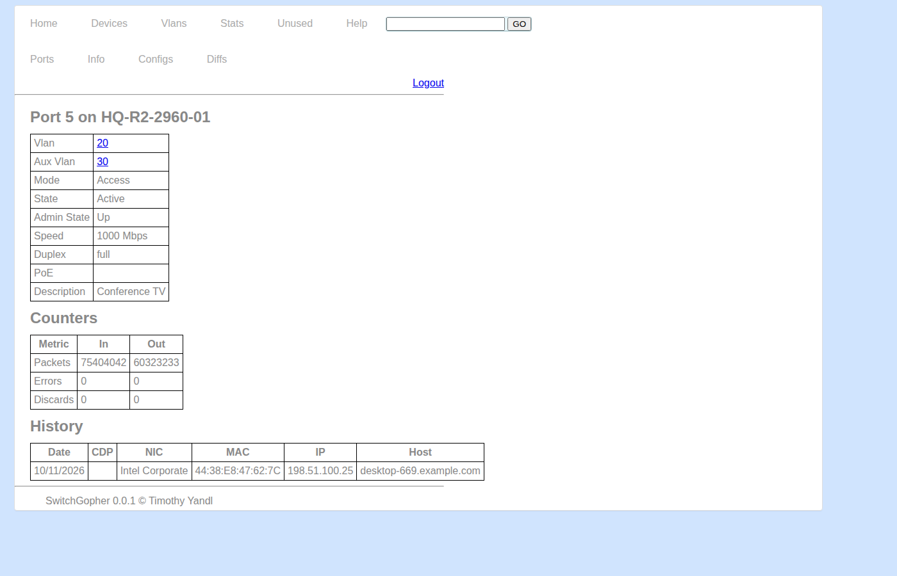
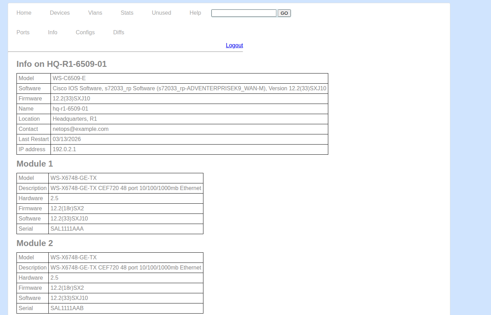
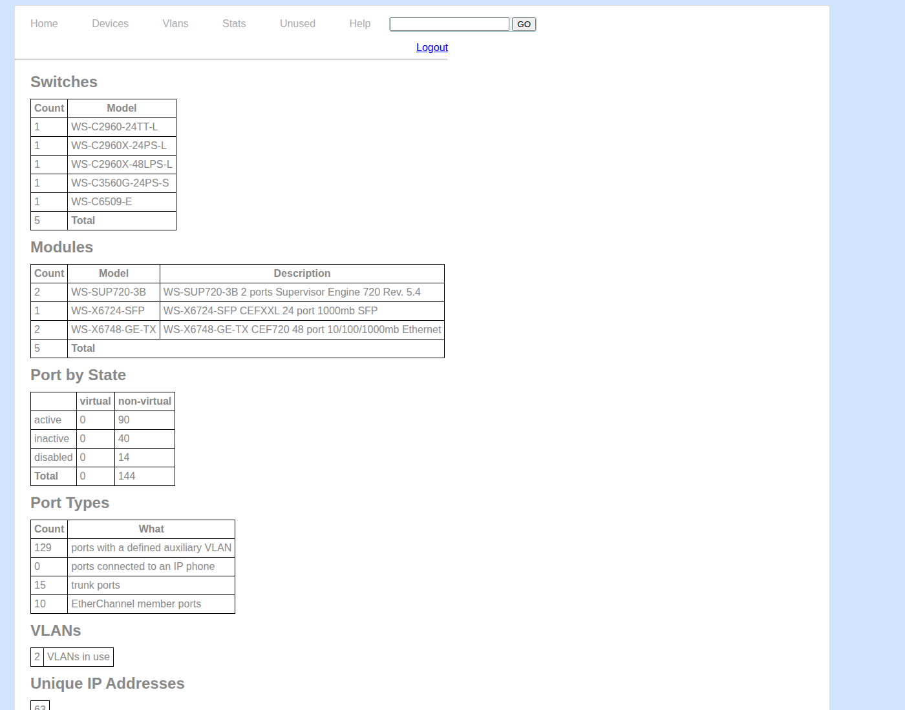

# SwitchGopher

SwitchGopher polls network switches over SNMP and serves a web UI showing
what is plugged into each port: link state, speed, VLAN, PoE, CDP neighbors,
and the MAC address, IP address and hostname of the device on the other end.
It is a Go rewrite of the Perl tool switchmap.
It only reads from your network; it never changes a switch.

Pages: Devices (browse and filter switches), per-switch Ports / Info /
Configs / Diffs, Vlans, Stats, Unused ports, and search by MAC or hostname.
The in-app Help page explains how to read them.

## Screenshots

Taken against fictional mock data. All 17 page captures are in
[`documentation/screenshots`](documentation/screenshots).

**Home**



**Devices:** browse and filter switches by category, building and room.



**Ports:** one row per port, with the device seen on it (vendor, MAC, IP, hostname).



**Port details:** one port's settings and traffic counters.



**Info:** model, firmware, location and uptime for one switch, plus its modules.



**Stats:** network-wide totals.



## Quick start

**Prerequisites:** Go 1.27 or newer. Nothing else is needed to run it (SQLite is
built in). Docker is optional (see below), and so is net-snmp's `snmpd`, which
is only used for development.

A switch must answer SNMP from the machine running SwitchGopher: either a v2c
community string or an SNMPv3 user, with read-only access.

```sh
# 1. Site configuration: copy each example and edit it for your network.
for f in buildings categories vlans devices; do
  cp configuration/$f.example.json configuration/$f.json
done

# 2. Make a login hash (see "Login" below), then start the server. The first
#    start creates the database and loads the configuration plus the
#    MAC-vendor list automatically.
echo 'choose-a-password' | go run ./cmd/switchgopher -hash-password 2>/dev/null
SWITCHGOPHER_PASSWORD_HASH='<paste the hash>' go run ./cmd/switchgopher
```

Open <http://localhost:8000/> and log in as `admin` with the password you
hashed. (Use `-port` for a different port. `go build -o switchgopher
./cmd/switchgopher` gives you a binary if you would rather not use `go run`.)

**What you should see.** The first start logs that the database was seeded.
Switches are polled every 5 minutes by default (the first poll starts
immediately), so pages fill in as polls succeed. The example `devices.json` uses
`${...}` credential placeholders, so until you set those variables (or replace
the example devices with your own) the log shows lines like
`device HQ-R1-3560-01: Community: environment variable CORE_COMMUNITY is not
set`. That is expected, not a bug; see "SNMP credentials" below. After editing
the files in `configuration/`, run `go run ./cmd/switchgopher -seed` to reload
them (a database that has already been seeded is not re-seeded automatically).

**Don't have a device list?** `-discover` sweeps a management subnet over
SNMP (or crawls one hop of CDP neighbors with `-discover-cdp=<device>`) and
writes candidates to `configuration/discovered-devices.json` for you to
review and copy into `devices.json`. It prompts for anything it needs unless
you pass flags such as `-discover-subnet`; `-discover-pattern` extracts
building/room/model from device names with a regex. Run
`go run ./cmd/switchgopher -help` for every `-discover-*` flag.

## Configuration

| File | Purpose |
|---|---|
| `configuration/buildings.json` | Building names and short codes |
| `configuration/categories.json` | Device categories (also the config-folder names) |
| `configuration/vlans.json` | VLAN IDs, names, subnets |
| `configuration/devices.json` | The switches to poll, with their SNMP credentials |
| `configuration/preferences.json` | Polling intervals, retention, paths, DNS/ARP settings |

The first four hold site data and credentials, so only the
`*.example.json` copies are tracked; the real files are gitignored. Each
example has a `Notes` entry explaining its fields; the app ignores `Notes`.

`preferences.json` is tracked. Each setting is an object with a
`description` (which ends in `required`, `type` and `default`) and a `value`.
The app reads only `value`, so you can delete the descriptions. Remove a
`value` to fall back to the built-in default.

### SNMP credentials

`devices.json` supports SNMPv2c (`Community`) and SNMPv3 (`SnmpVersion: "3"`
plus `Username`, `SecurityLevel`, `AuthProtocol`, `AuthPassphrase`,
`PrivProtocol`, `PrivPassphrase`); the two can be mixed per device.

To keep secrets out of files and the database, write a credential as a
`${NAME}` placeholder:

```json
{ "Device": "HQ-R1-3560-01", "Community": "${CORE_COMMUNITY}" }
```

The database stores the placeholder as written, and the value is read from
the environment variable `NAME` each time the device is polled. This applies
to `Community`, `Username`, `AuthPassphrase` and `PrivPassphrase`.

- A variable that is unset or empty makes that device's poll fail with an
  error naming the device and variable.
- Write `$${` for a literal `${`.
- Plain values still work, but are stored in plaintext in `devices.json` and
  the database.
- The variables must be set in the server's environment whenever it runs.
  To rotate a credential, change the variable and restart; no re-seed is
  needed.

### Login

The web UI sits behind one shared username and password, using a signed
session cookie that lasts 12 hours. The server refuses to start without a
password hash.

- Generate a bcrypt hash: `echo 'password' | go run ./cmd/switchgopher -hash-password`
- Provide it with `SWITCHGOPHER_PASSWORD_HASH` (preferred, keeps it out of
  the process list) or `-auth-password-hash`. Single-quote it in a shell,
  because the hash contains `$`.
- The username is `admin` unless you pass `-auth-user`.

Traffic is plain HTTP, so run it behind TLS anywhere untrusted. A TLS-terminating
proxy should send `X-Forwarded-Proto: https`, which marks the session cookie `Secure`. Per-user
accounts (LDAP or SSO) are on the to-do list.

## MIB files

A MIB is a document that gives names to the numbers (OIDs) a device reports.
SwitchGopher fetches data with fixed numeric OIDs, so most of its work does not
need MIBs. It uses them in one place: to turn a device's `sysObjectID` into a
model name (for example, a particular Cisco Catalyst) and to read entity names.
The MIB files live in `resources/mibs/` (standard MIBs) and
`resources/mibs/cisco/` (Cisco). Each file is named after its module, with no
extension (`IF-MIB`, not `IF-MIB.mib`). They are loaded once at startup; if one
cannot be loaded the server stops with `initMIBs: failed loading <NAME>`.

**Adding a MIB**

1. Save the file as `resources/mibs/<MODULE-NAME>`, or
   `resources/mibs/<vendor>/<MODULE-NAME>` for a vendor MIB. The module name is on
   the file's first line (`CISCO-EXAMPLE-MIB DEFINITIONS ::= BEGIN`).
2. Only `resources/mibs` and `resources/mibs/cisco` are searched. For a new
   vendor directory, add a matching `gosmi.AppendPath(mibDir + "/<vendor>")`
   line next to the `cisco` one in `InitMIBs` (`internal/snmp/device.go`).
3. Add the module name to the `modules` list in the same function, after any
   module it imports (see the file's `IMPORTS` section). If startup reports an
   unresolved import, add the file it names too.
4. Run `go test ./...` and start the app. No "failed loading" error means it
   worked. Note where the file came from in `resources/mibs/README.md`, and check
   the MIB's license before committing it.

**Where to find MIBs**

- **Check what is already here first**, and the notes in
  [`resources/mibs/README.md`](resources/mibs/README.md).
- **LibreNMS's MIB collection** covers many vendors and is where this project's
  MIBs came from: <https://github.com/librenms/librenms/tree/master/mibs>. A file's
  raw URL is `https://raw.githubusercontent.com/librenms/librenms/master/mibs/<NAME>`
  (Cisco's are under `mibs/cisco/`).
- **Cisco:** the SNMP Object Navigator,
  <https://snmp.cloudapps.cisco.com/Support/SNMP/do/BrowseOID.do>, looks up an OID
  or MIB name and says which MIB defines it. Cisco MIB names start with `CISCO-`.
- **IETF standard MIBs** (`IF-MIB`, `ENTITY-MIB`, `BRIDGE-MIB`, ...) are
  published inside RFCs (<https://www.rfc-editor.org/>; search for the MIB name).
  LibreNMS has them already extracted.
- **IANA MIBs**, such as `IANAifType-MIB`:
  <https://www.iana.org/assignments/ianaiftype-mib/ianaiftype-mib>.
- **IEEE 802.1 MIBs** (`IEEE8021-*`, for example 802.1X port authentication):
  <https://www.ieee802.org/1/files/public/MIBs/>.
- **Another vendor?** Take the number after `1.3.6.1.4.1.` in the device's
  `sysObjectID` (its enterprise number) and look it up at
  <https://www.iana.org/assignments/enterprise-numbers/> to find the vendor, then
  check that vendor's support site or LibreNMS.
- **On your machine:** net-snmp installs some MIBs in `/usr/share/snmp/mibs`, and
  `snmptranslate -Td <OID>` explains an OID. Adding support for a whole vendor
  also needs a driver; see
  [`internal/snmp/drivers/README.md`](internal/snmp/drivers/README.md).

## Troubleshooting

| Symptom | Likely cause and fix |
|---|---|
| `web login not configured: ...` and the server exits | `SWITCHGOPHER_PASSWORD_HASH` is missing or not a bcrypt hash. Generate one with `-hash-password` and single-quote it (it contains `$`) |
| `environment variable X is not set` for a device | `devices.json` references `${X}` and the server's environment lacks it. Set it, or use a literal value |
| Pages are empty | Nothing has polled successfully yet. Read the log for `poll <device>:` errors. `go run ./cmd/switchgopher -pollonce <device>` polls one device and prints the error |
| `context deadline exceeded` on a poll | The device did not answer: wrong address or port, a firewall or SNMP access list, or the wrong community / SNMPv3 settings |
| `listen tcp :8000: bind: address already in use` | Something else uses the port; pass `-port` |
| A device is missing from Devices | It is not in `configuration/devices.json`, or you have not re-run `-seed` since adding it |
| Configs and Diffs say "not available" | SwitchGopher does not fetch configs itself; put saved copies under `resources/configs/` (see its README) |
| Logs say `no implementation registered for group ...` | Normal for devices that do not support an optional feature; that group is skipped |
| From Docker, devices time out | Your devices may only accept SNMP from the host's address; try `network_mode: host` |

## Docker

Requires Docker with the Compose plugin. The image is a small Alpine image
that runs as a non-root user and has a health check. These steps work on your
own machine or on a server.

1. **Site configuration.** Copy and edit the config files exactly as in the
   quick start. Do this first: the container bind-mounts `./configuration`, and
   with no `devices.json` it starts with **no devices** (the log says
   `devices.json not found, treating as empty`).

   ```sh
   for f in buildings categories vlans devices; do
     cp configuration/$f.example.json configuration/$f.json
   done
   ```

2. **Secrets.** Create `.env` and put the login hash and any credential
   variables in it.

   ```sh
   cp .env.example .env
   echo 'choose-a-password' | docker compose run --rm -T switchgopher -hash-password 2>/dev/null
   ```

   Paste the printed hash into `.env` as `SWITCHGOPHER_PASSWORD_HASH='...'`
   (keep the single quotes, because the hash contains `$`). Then add one line
   `NAME=value` for each `${NAME}` placeholder used in `devices.json`. Compose
   reads `.env` for every command, so create the file before running anything.

3. **Start it.**

   ```sh
   docker compose up -d --build
   docker compose ps          # STATUS should become "healthy"
   docker compose logs -f     # watch the polls
   ```

   Open `http://<host>:8000/` and log in as `admin`. The first start seeds the
   database automatically.

**Everyday commands**

| Task | Command |
|---|---|
| Reload `configuration/*.json` | `docker compose run --rm switchgopher -seed` (no restart needed; new devices are polled on the next cycle) |
| Poll one device and show errors | `docker compose run --rm switchgopher -pollonce <device>` |
| See what is wrong | `docker compose logs --tail 100` |
| Change the host port | Edit `ports:` in `docker-compose.yml`, for example `"8080:8000"` |
| Change the login username | Add `command: ["-auth-user", "ops"]` to the service |
| Stop (keeps data) / delete everything | `docker compose down` / `docker compose down -v` |

The container restarts on its own after a reboot (`restart: unless-stopped`).

### Running on a server

- **Get the code onto the server.** Clone the repository there and run the
  steps above. (If the repository is private the server needs access to it, such
  as a deploy key. Alternatively build elsewhere and copy the image with
  `docker save` and `docker load`.)
- **Put TLS in front.** The app speaks plain HTTP. Run a reverse proxy
  (nginx, Caddy, Traefik) that terminates HTTPS and forwards to port 8000, and
  have it send `X-Forwarded-Proto: https` so the session cookie is marked
  `Secure`. Publish the container port only to the proxy by writing
  `"127.0.0.1:8000:8000"` in `ports:`.
- **Network access to your switches.** The container needs outbound UDP to the
  switches (port 161 by default). On Docker's default network the switches see
  the server's address, so allow that address in their SNMP access lists. If
  they only accept SNMP from the server itself and that does not work, use
  `network_mode: host` (the `ports:` setting is then ignored and the app listens
  on the host directly; use `-port` if 8000 is taken).
- **What to back up.** `configuration/` and `.env` are the things you cannot
  recreate. The database can be rebuilt (`-seed`, then polling refills it), but
  the history of where each MAC address was seen lives only in the `data`
  volume. Saved device configs live in the `configs` volume.
- **Updating.** `git pull && docker compose up -d --build`. There are no
  database migrations yet, so before upgrading a deployment that holds real
  history, check whether the new version changed the schema (`internal/store/store.go`).

## Command-line flags

Run `switchgopher -help` for the full list, grouped by purpose, with defaults,
examples and the environment variables.

| Flag | Meaning |
|---|---|
| `-seed` | Load `configuration/*.json` and the OUI list into the database, then exit (a never-seeded database is seeded automatically) |
| `-port` | HTTP port (default 8000) |
| `-db` | SQLite file (default `resources/inventory.sqlite`) |
| `-auth-user`, `-auth-password-hash` | Login username and bcrypt hash |
| `-hash-password` | Print a bcrypt hash for a password read from stdin, then exit |
| `-pollonce=<device>` | Poll one device once and exit (handy for testing) |
| `-discover` and `-discover-*` | Device discovery; see above |

## Development

```sh
go build ./... && go vet ./... && go test ./...
```

Documentation for contributors:

- [`CONTRIBUTING.md`](CONTRIBUTING.md): environment, checks, running against a
  fake switch, how to add a page, a driver or a setting, and conventions.
- [`documentation/ARCHITECTURE.md`](documentation/ARCHITECTURE.md): how the
  poller, the vendor drivers, the database and the web UI fit together, plus a
  glossary of SNMP terms.
- [`documentation/TODO.md`](documentation/TODO.md): design decisions and open
  work.
- [`internal/snmp/drivers/README.md`](internal/snmp/drivers/README.md): adding
  support for another vendor.
- [`resources/configs/README.md`](resources/configs/README.md): where saved
  device configs go.

Not yet validated against real Cisco hardware, only a local net-snmp
simulator and unit tests.
