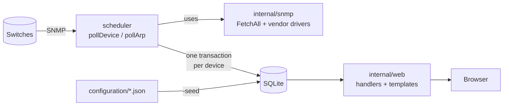

# Architecture

How SwitchGopher works, for someone new to the code. For setup and day-to-day
use see the [README](../README.md); for how to make changes see
[CONTRIBUTING.md](../CONTRIBUTING.md). [`TODO.md`](TODO.md) is the long design
log (decisions, dead ends, what is still open); read it when you need to know
*why* something is the way it is.

## The big picture

SwitchGopher does two independent jobs that meet in a SQLite database:

1. **A poller** asks every switch about itself over SNMP on a schedule and
   writes the answers to the database.
2. **A web UI** reads the database and shows it. It never talks to a switch.

Everything runs in one process (`cmd/switchgopher`): the poller is a goroutine
and the web server is the main goroutine.

## SNMP in two paragraphs

SNMP lets you read values from a device. Each value has an **OID**, a dotted
number such as `1.3.6.1.2.1.1.5.0` (the device's name). A **MIB** is a
document that gives those numbers names and meanings; the MIB files we use are
in `resources/mibs/`. You can read one value (`Get`) or a whole table (`Walk`).
Security is either a shared password called a **community string** (v2c) or
per-user credentials with optional authentication and encryption (v3).

The tables we care about: **IF-MIB** (one row per interface, indexed by
`ifIndex`), **BRIDGE-MIB** (the switch's forwarding table, "FDB", which MAC
addresses were seen on which port), **CDP** (Cisco's neighbor discovery), and
the router's **ARP table** (which IP belongs to which MAC). The library we use
is [gosnmp](https://github.com/gosnmp/gosnmp).

## Package map

| Path | What it does |
|---|---|
| `cmd/switchgopher/main.go` | Entry point: flags, startup order, the one-shot modes (`-seed`, `-pollonce`, `-hash-password`) |
| `cmd/switchgopher/discover.go` | The `-discover` flags and the interactive prompts for the discovery tool |
| `internal/config` | Loads `configuration/preferences.json` into a process-wide map (`config.Int`, `config.String`) |
| `internal/model` | Plain data types shared by the fetch and storage layers (`Device`, `Port`, `Node`, `Module`) |
| `internal/snmp` | Fetches everything from one device. `FetchAll` is the entry point. Defines the "groups" and the vendor registry |
| `internal/snmp/drivers/generic` | Standard-MIB implementations of each group. Works on any vendor |
| `internal/snmp/drivers/cisco` | Cisco-only overrides (VLAN membership, CPU/memory, config management) |
| `internal/snmp/drivers/register` | Blank-imports every driver so each one registers itself |
| `internal/snmp/snmputil` | Small helpers for walking tables and decoding SNMP values |
| `internal/scheduler` | The poll loop: builds SNMP sessions, runs `FetchAll`, writes results in a transaction. Also the ARP/DNS pass and pruning |
| `internal/store` | All SQL. Schema, seeding, and the write-back functions the poller calls |
| `internal/dns` | Reverse-DNS lookups used to fill in node hostnames |
| `internal/oui` | Parses the IEEE vendor list (MAC prefix to company name) |
| `internal/discover` | The bootstrapping tool: sweeps a subnet or crawls CDP neighbors to find devices |
| `internal/web` | HTTP router, login, one handler per page, shared helpers |
| `resources/` | Templates, CSS, JS, MIB files, the OUI list, saved device configs |
| `configuration/` | Site data and settings (see below) |

Dependencies only point downward: `web` and `scheduler` use `store` and
`snmp`; `snmp` and `store` both use `model`; nothing uses `web` or `cmd`.

## Startup (`main.go`)

1. Parse flags. `-hash-password` prints a bcrypt hash and exits.
2. Open the SQLite file (`-db`) and apply the schema (`store.Setup`, which only
   creates missing tables).
3. Load `configuration/preferences.json`.
4. `-seed` loads site data and exits. Otherwise, if the database has never
   been seeded, do the same automatically (`store.NeedsSeed`).
5. `-discover` and `-pollonce` run their one job and exit.
6. For the server: load the MIBs, require a valid login hash, start
   `scheduler.StartScheduler` in a goroutine, then serve HTTP.

## Polling

`scheduler.StartScheduler` runs three loops on tickers: poll all devices,
poll routers' ARP tables, and prune old data. Polling is bounded by a worker
limit (`poll_concurrency`).

For each device, `pollDevice`:

1. `buildSession` makes an SNMP session from the device's row, using v2c or v3
   as configured. This is also where `${NAME}` credential placeholders are
   replaced with environment variables.
2. `snmp.FetchAll` gathers everything into a `Result` (see below).
3. In **one database transaction** it replaces the device's ports and modules,
   appends new node sightings, and updates the device row. If anything fails
   the whole poll rolls back, so a half-updated device is never visible.

Poll failures (timeouts, bad credentials) are logged and the device keeps its
previous data until the next successful poll.

The ARP pass (`pollArp`) reads routers' ARP tables to learn each MAC's IP, then
a reverse-DNS pass fills in hostnames. Both can only enrich nodes that a switch
has already reported.

### `FetchAll` and the vendor registry

A **group** is one coherent piece of fetching: identity, ports, nodes, CDP,
modules, port counters, PoE, and so on (the list is in
`internal/snmp/registry.go`; each has an interface in `groups.go`). `FetchAll`:

1. reads the basics and the device's `sysObjectID` to work out its **vendor**
   (`DeriveVendorKey`, for example Cisco);
2. for each group, picks that vendor's implementation if one is registered,
   otherwise the generic one, otherwise skips the group;
3. merges the results by `ifIndex`.

Ports and nodes failing aborts the poll. Every other group is best-effort: a
failure is logged and the rest continue. Drivers register themselves in
`init()`, the same pattern as Go's `database/sql` drivers. To add a vendor see
[`internal/snmp/drivers/README.md`](../internal/snmp/drivers/README.md).

## Database

SQLite, accessed only from `internal/store` (plus read-only queries in the web
handlers). The schema is in `store.go`.

| Table | Filled by | Holds |
|---|---|---|
| `buildings`, `categories`, `vlans` | `-seed` from `configuration/` | Site vocabulary. VLANs also get `Source = 'discovered'` rows if a switch reports an unknown ID |
| `devices` | `-seed`, then updated by polls | One row per switch: config columns plus what SNMP reported |
| `ports` | polls | Latest snapshot of every interface (replaced each poll) |
| `modules` | polls | Line cards in chassis switches (replaced each poll) |
| `nodes` | polls | History of MAC sightings. Appended only when something changed; capped per MAC and pruned by age |
| `oui` | `-seed` | MAC prefix to vendor name. Reference data, not site data |
| `deviceTypes` | `-seed` | Currently just `generic` |

Two things that surprise people:

- Re-running `-seed` replaces `devices` rows, which blanks the polled columns
  until the next poll. That is expected.
- The schema has **no migrations** yet, because nothing had been deployed. Once
  a release has real data, a schema change needs a migration step in
  `store.Setup`.

All SQL uses placeholders. The only place a column name is pasted into a query
is `getSelection`/`unusedSelection`, and their callers pass fixed names.

## Web UI

`internal/web/router.go` registers every route. `NewRouter` wraps the router in
two middlewares: the login check (`auth.go`) and baseline security headers.

A page is three small pieces:

- a **handler** in `handlers_*.go` that reads query parameters, runs SQL, and
  builds a `map[string]Any`;
- a **template** in `resources/templates/*.tmpl` (Go `html/template`, which
  escapes output automatically). `_base.tmpl` defines the shared head, nav
  bar and footer; `_switch.tmpl` defines the per-switch tab bar;
- optionally a **stylesheet** in `resources/styles/`. `base.css` is on every
  page and imports `_tables.css`, so tables are styled everywhere.

Filters and sorting are plain query-string parameters with `onchange` form
submits; there is almost no JavaScript (`resources/scripts/base.js`).

Handlers redirect to the home page (`redirectHome`) when a required parameter
is missing.

Login is one shared username and password. A signed cookie (`auth.go`) holds an
expiry time; the signing key is random per process, so a restart logs everyone
out. See the README for how to set the password hash.

## Configuration

| File | Used for |
|---|---|
| `configuration/{buildings,categories,vlans,devices}.json` | Site data, loaded by `-seed`. Not tracked in git: copy the `*.example.json` files |
| `configuration/preferences.json` | Tunables (poll interval, retention, paths). Tracked. Each entry has a `description` and a `value`; only `value` is read |
| `.env` / environment | `SWITCHGOPHER_PASSWORD_HASH`, and any variables referenced as `${NAME}` in `devices.json` |

Credentials in `devices.json` may be `${NAME}` placeholders. The database
stores the placeholder; `scheduler/secrets.go` expands it from the environment
every time a session is built, so secrets never reach SQLite.

## Discovery tool

`-discover` (in `internal/discover` and `cmd/switchgopher/discover.go`) finds
devices to monitor. It sweeps a subnet with a quick SNMP probe, or crawls one
hop of CDP neighbors, decides whether a responder looks like a switch (bridge
bit in `sysServices`, else a count of Ethernet ports), optionally extracts
building/room/model from device names with regular expressions, and writes
candidates to `configuration/discovered-*.json` for a human to review. It never
edits `devices.json`.

## Testing

Unit tests sit next to the code (`go test ./...`). Parts that need a real
switch cannot be unit tested; see [CONTRIBUTING.md](../CONTRIBUTING.md) for
running against a local SNMP simulator and for mock data. Known gaps: FDB and
CDP tables are not exercised by the simulator, and nothing has been validated
against real Cisco hardware yet.

## Glossary

- **Node:** a device seen on a switch port, identified by MAC address.
- **FDB:** forwarding database, the switch's table of MAC to port.
- **CDP:** Cisco Discovery Protocol; switches report their neighbors.
- **ARP:** maps IP addresses to MAC addresses (read from routers).
- **OUI:** the first three bytes of a MAC address, which identify the vendor.
- **ifIndex:** a switch's number for an interface; used as the port number.
- **Trunk / access port:** a trunk carries many VLANs (usually to another
  switch); an access port carries one.
- **PoE:** power over Ethernet.
- **EtherChannel / aggregate:** several ports bundled into one logical link.
- **sysObjectID:** an OID that identifies the device's make and model.
